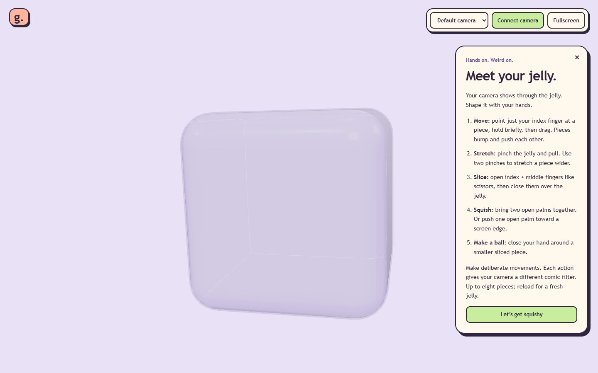

# Gestures — Jelly Camera

A camera playground where your hands stretch, slice, squish and move translucent jelly. Each action turns the whole camera into a different comic-book panel.



Built with vanilla JavaScript, Three.js and local MediaPipe hand tracking. Video stays on your PC; there is no cloud inference or microphone capture.

## Run on Windows

Install Python and Node.js, then open PowerShell in this repository:

```powershell
powershell -NoProfile -File scripts/setup.ps1
```

Double-click **Start Gestures.cmd** and open **http://127.0.0.1:8765/**. The existing Gestures desktop shortcut also starts/reuses the server and opens your default browser. Setup downloads the required local libraries and hand model; subsequent runs serve them locally.

Select your webcam and connect. Dismiss the introduction for a clear view—it appears once per page load. Camera selection, connection and fullscreen are the only persistent controls. No Studio, model editor or debug toolbar.

## Play with your hands

| Gesture | Jelly response | Camera treatment |
| --- | --- | --- |
| Raise only your index finger over a piece, hold briefly, then move | Drag that piece; it pushes and softly rebounds against others | Persistent comic base |
| Pinch thumb/index inside a piece and pull; use two pinches for a wider stretch | Stretch the selected piece | Electric speed/color lines |
| Open index/middle fingers like scissors, then close over the jelly | Split a piece in two; reopen before another cut | Black-and-white manga cuts |
| Bring open palms together around a piece, or press one palm toward a screen edge | Compress the jelly | Underwater cartoon waves and bubbles |
| Close your hand around a smaller sliced piece and hold briefly | Morph that piece into a ball | Warm pink/yellow halftone pop |

Up to **eight pieces**. The jelly is semi-transparent so you can see yourself behind it. Changing drag pose or losing tracking releases safely without a throw. Disconnect preserves pieces; reload starts fresh. Keep hands well lit and separated, and make deliberate gestures.

## Preserving camera quality

- Request **1080p / 30fps** as preferences, with native sizing where supported. The browser may choose another supported mode; compatibility recovery can fall back to VGA.
- Keep the display canvas at the **actual negotiated capture dimensions**. Only the separate hand-tracking copy is resized to 640px width.
- Preserve **85% of original camera color/detail** in the default comic blend, with no baseline saturation boost. Ink and print texture remain; action filters intentionally make stronger temporary changes.
- Acquire frames on video-frame callbacks where available and avoid repainting unchanged camera frames in static modes.

These choices follow [browser capture guidance](https://developer.mozilla.org/en-US/docs/Web/API/MediaDevices/getUserMedia) and [video-frame scheduling documentation](https://developer.mozilla.org/en-US/docs/Web/API/HTMLVideoElement/requestVideoFrameCallback). See [research and implementation details](docs/research/CAMERA-QUALITY.md). Actual webcam fidelity and responsiveness depend on the device/browser and still need a live Brio check.

If the camera is busy, close other tabs/apps using it and reconnect. Grant video permission in your browser. The app retries once on the same device; it never silently changes cameras. Reduced-motion preferences remove moving waves/streaks and retain gentler static filtering.

## Verify and build

```powershell
npm test
powershell -NoProfile -File scripts/test-frontend-skills.ps1
npm run build
```

The frontend runner starts its own private loopback server, uses generated video and synthetic hand landmarks, and saves reports/screenshots under ignored `build/frontend-skills/`. It does not open your physical webcam. `npm run test:browser` / `npm run test:jelly-browser` run the same active browser suite against `GESTURES_TEST_URL` (default `http://127.0.0.1:8777/`).

`npm run build` produces a self-contained `dist/` with local assets for root or subpath hosting. It does not publish anything. Browser camera access requires an appropriate secure context such as localhost or HTTPS.

## Project structure

- `web/jelly-model.js`: hand classification, piece targeting, drag/collision rules and effects.
- `web/jelly-scene.js`: translucent procedural meshes, ball morph and damped deformation.
- `web/app.js`: webcam/worker lifecycle, camera compositing and comic layers.
- `web/webcam-source.js`: capture preferences, cancellation and recovery.
- `server.py`: local assets and optional historical hardware bridge. Serial/device access stays disabled by default.
- `.agents/skills/`: project-specific UI and motion workflows adapted from reviewed local skills.

This is bounded rounded-cube splitting and approximate screen-plane contact, not arbitrary volumetric cutting, room mapping or 3D soft-body simulation. Historical Donut/Catch snapshots live in `design/donut-lab/`; drawing storage and private hardware backups remain untouched. Private configuration, downloaded models, generated builds and recordings are ignored by Git. Third-party notices are in [THIRD_PARTY_NOTICES.md](THIRD_PARTY_NOTICES.md).
