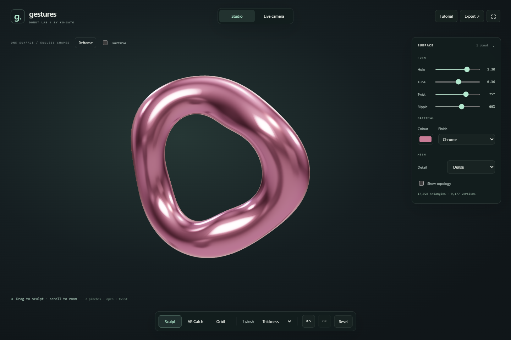

# Gestures / Donut Lab

One donut you can reshape, throw and catch with your hands. A Three.js surface experiment by
**kg-sato**, with a camera-free mouse mode and local webcam hand tracking.



## Run

With Python and Node.js installed, open PowerShell in this folder:

```powershell
powershell -NoProfile -File scripts/setup.ps1
.\.venv\Scripts\python.exe server.py
```

Open **http://127.0.0.1:8765/**. After setup, `Start Gestures.cmd` starts it again.
Studio works immediately; Live camera asks for video access. No microphone or
external inference service is used. Downloaded libraries and models stay local.

## Controls

| Input | What it does |
| --- | --- |
| One thumb/index pinch, move up/down | Thicken/thin the tube |
| Select Ripple, then one pinch up/down | Add/remove waves in the ring |
| Two pinches, spread/squeeze | Open/narrow the hole |
| Two pinches, tilt | Twist the oval cross-section |
| Mouse/touch drag in Sculpt | Horizontal changes hole radius; vertical sculpts the selected tool |
| Drag in Orbit | Turn the view without changing geometry |
| Scroll in Studio | Zoom |
| Undo / Redo | Restore a whole drag, pinch session or slider edit |

Pinches work anywhere in the camera view; hitting a small object target is not
required. Hand markers show the filtered positions and active pinch state. The
controller stabilizes acquisition for 100 ms, debounces opening for 70 ms, and
pauses the entire edit if one participating hand disappears. Recovery establishes
new baselines. Loss after 260 ms ends the edit; a surviving pinch must open before
rearming. Blur, camera changes and manual controls safely release active input.

Shortcuts: **S** Sculpt, **V** Orbit, **R** Reset, **Ctrl+Z** Undo,
**Ctrl+Shift+Z** Redo. The tutorial contains the full guide.

## AR Catch

Choose **AR Catch** to play with the same donut as a small throwable object. In
Live camera, pinch near it to pick it up, flick your hand and open the pinch to
throw. Keep the other hand pinched near its flight path to catch. The green
receiving circle shows the catch window; the score tracks catches and streaks.
**New round** returns the donut to the center and clears the score.

Studio also supports mouse/touch drag-and-flick throws. Catch uses buffered recent
hand motion from before the release gesture, a capped throw speed, fixed-step
gravity and bounces, and swept-path checks so fast motion cannot simply skip the
catch window. A short cooldown prevents immediate self-catches. Hand tracking
loss, blur and disconnection never launch the object. Sculpt parameters are
preserved while Catch mode moves the donut; switching back restores the sculpture.

This is a camera-plane AR game, with no real-world depth or collision sensing.
The approach is informed by official Meta, Three.js and A-Frame examples;
[research and implementation notes](docs/research/AR-CATCH.md) link the sources.

## Surface and topology

Gestures change **vertex positions**, rather than translating or scaling a rigid
ring. Hole radius, tube thickness, twist and ripple control a periodic torus surface.
Normals are recomputed and averaged across the duplicated UV seams so the surface
remains smooth. The renderer reuses its position buffer while sculpting.

**Show topology** draws the mesh; **Detail** changes its tessellation:

| Detail | Ring × tube segments | Triangles |
| --- | --- | --- |
| Light | 72 × 28 | 4,032 |
| Balanced | 112 × 40 | 8,960 |
| Dense | 160 × 56 | 17,920 |

The donut keeps one open hole. Sculpting changes its surface; changing mesh detail
changes vertex/triangle connectivity and density. Bounds keep the hole open and
prevent a collapsed surface. Materials include chrome, clay, glass and hologram.

Save/open editable Donut Lab JSON scenes, export the actual deformed geometry as
GLB, or capture a PNG. A camera-mode PNG includes the local camera image. Editing
is session-only until you explicitly save a file. Old multi-object scene files
are rejected without replacing your donut.

## Portfolio build

```powershell
npm.cmd run build
```

`dist/` is a self-contained static site and supports subpaths such as `/Gestures/`.
Upload that directory to a static host. Live camera requires HTTPS or localhost.
The static site does not need Python or USB APIs. No deployment is automatic.

## Verification

```powershell
npm.cmd test
.\.venv\Scripts\python.exe -m unittest discover -s tests -p "test_*.py"
# With the app already running in another terminal:
$env:GESTURES_TEST_URL='http://127.0.0.1:8765/'
npm.cmd run test:donut-browser
npm.cmd run test:catch-browser
```

The unit suite covers mesh winding, closed seams, noncollapsed holes, deformation,
tessellation, pinch stability, hand identity, jitter, variable frame delivery,
loss/recovery and undo documents. Browser checks exercise real WebGL, pointer
capture/blur, mouse-versus-orbit ownership, injected landmark streams, generated
webcam/MediaPipe, export/import, mobile controls and local runtime requests.
Generated input cannot establish physical webcam accuracy or lighting tolerance.

Earlier drawing, particle and multi-object studio sources are retained in
`design/`. Their saved drawing data and hardware backups remain untouched. The
active page has one donut; assembly tools and other shapes are not in its UI.
[Third-party notices](THIRD_PARTY_NOTICES.md) retain library licences. Historical
implementation evidence is recorded in [docs/STATUS.md](docs/STATUS.md).
